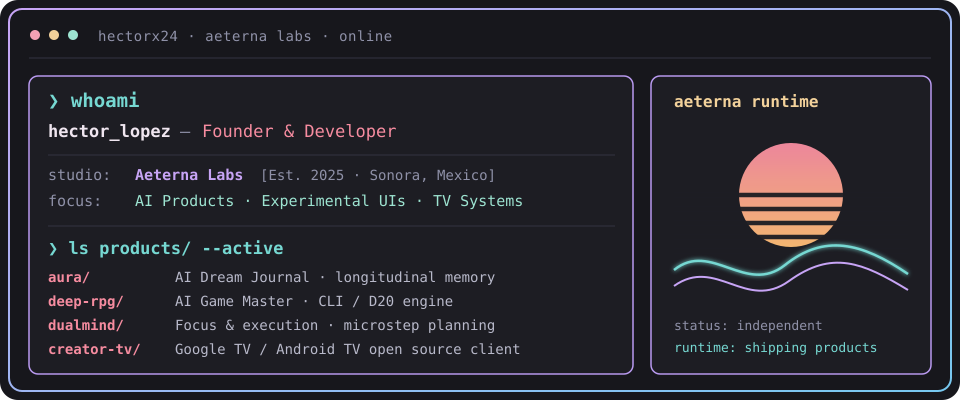

<!-- RETRO TERMINAL BANNER -->
<a href="https://hector-portfolio-sigma.vercel.app/" target="_blank">
  <picture>
    <source media="(prefers-color-scheme: dark)" srcset="assets/banner-dark.v9.svg">
    <source media="(prefers-color-scheme: light)" srcset="assets/banner-light.v9.svg">
    
  </picture>
</a>

 

  

&nbsp;&nbsp;

---

## `$ whoami`

  

 

## `$ cat tech-stack.yaml`

<table border="1" cellpadding="14" bgcolor="#17171c">
  <thead>
    <tr>
      <th colspan="2" align="left"><code>hectorx24:~$ cat tech-stack.yaml</code></th>
    </tr>
  </thead>
  <tbody>
    <tr>
      <td width="50%" valign="top"><code>├─ ✦ core_languages:</code>  
        
        
         
        <code>Python · TypeScript · JavaScript</code>
      </td>
      <td width="50%" valign="top"><code>├─ ⚛ frontend_&amp;_ui:</code>  
        
        
        
        
         
        <code>React · Vite · Tailwind · Modern CSS / HTML</code>
      </td>
    </tr>
    <tr>
      <td valign="top"><code>├─ 📱 platforms_&amp;_tv:</code>  
        
        
         
        <code>Android TV / Google TV · ADB · Linux · macOS</code>
      </td>
      <td valign="top"><code>├─ 🧠 ai_&amp;_backend:</code>  
        
        
        
         
        <code>LLM Pipelines · FastAPI · Node.js · SQLite / Postgres</code>
      </td>
    </tr>
    <tr>
      <td colspan="2" valign="top"><code>╰─ ⚙ tooling_&amp;_workflow:</code>  
        
        
        
         
        <code>Git · GitHub Actions · Bash / Zsh · Neovim / VS Code</code>
      </td>
    </tr>
  </tbody>
  <tfoot>
    <tr>
      <td colspan="2"><code>status: shipping_active&nbsp;&nbsp;·&nbsp;&nbsp;environment: aeterna-labs-production</code></td>
    </tr>
  </tfoot>
</table>

---

## `$ ls projects/ --featured`

### 🌌 Aura — AI Dream Journal (Flagship)
> AI-assisted personal dream journal designed for longitudinal introspection. Features audio/voice recording for morning recall, recurring pattern extraction, dream motif clustering, and persistent long-term semantic memory.
>
> `AI Product` `Longitudinal Memory` `Voice Capture` `Semantic Search` `Flagship`  
> 🔗 [aeternalabs.lat](https://www.aeternalabs.lat)

 

### 🎲 Deep RPG Terminal — AI Game Master Engine
> Interactive command-line roleplaying experience governed by an autonomous AI Game Master. Features dynamic world state tracking, D20 dice mechanics, procedural narrative branches, persistent campaign state, and real-time ASCII environment rendering.
>
> `AI Systems` `CLI / TUI` `Game Loop` `D20 Engine` `ASCII Rendering`

 

### ⚡ DualMind — Cognitive Focus & Micro-Planning System
> Minimalist execution system designed to eliminate analysis paralysis and task overwhelm. Enforces a hard limit of 3 concurrent active priorities, recursively decomposing complex projects into atomic, non-intimidating microsteps.
>
> `Productivity Engine` `Execution Systems` `Microsteps` `State Machine`

 

### 📺 Creator TV — TV-First Client for Google TV & Android TV
> Unofficial, open-source TV-first video and media interface tailored specifically for the 10-foot living room experience. Built with a responsive 720p/1080p/4K grid layout, native Android TV IME / Google TV keyboard integration with phone-assisted remote typing, and full D-pad directional navigation.
>
> `Open Source` `Android TV` `Google TV` `React` `ADB Tooling` `TV Navigation`  
> 🔗 [github.com/hectorx24/creator-tv](https://github.com/hectorx24/creator-tv)

---

## `$ connect --contact`

&nbsp;&nbsp;
&nbsp;&nbsp;
&nbsp;&nbsp;
&nbsp;&nbsp;

 

Crafted with passion from Sonora, Mexico · Founder @ <a href="https://www.aeternalabs.lat">Aeterna Labs</a> 
<small>Visual concept inspired by <a href="https://github.com/pagaliv">Pablo Galilea (@pagaliv)</a> &amp; <a href="https://github.com/macu-dev">@macu-dev</a></small>

